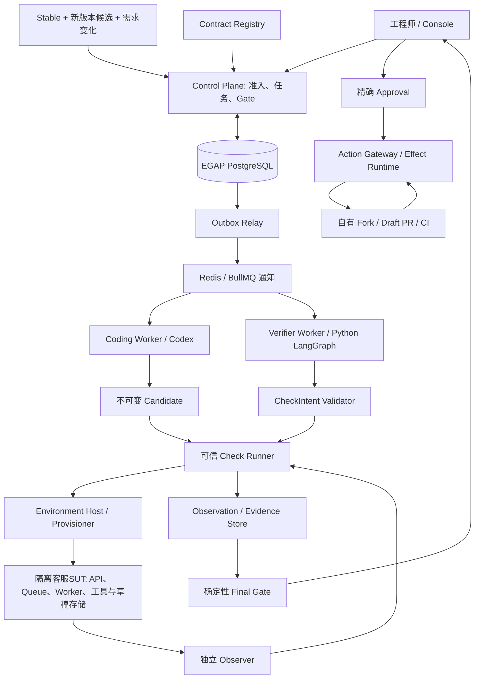

# 01 · 系统架构与共同接口

状态：`GENAI_MIGRATION_IN_PROGRESS`。通用骨架与 file-lab 已实现；下文的生产 Runtime、独立GenAI工具/模型观察、Agent 和发布域仍是目标架构。前置：[00 总体计划](00-overall-plan.md)。本章是各实现步骤共享的架构基线；调整实体、身份或状态时同步更新 [91 决策记录](91-decision-log.md)。

## 1. 先看三个事实域

客服SUT的工单/Job/账单/草稿存储拥有业务事实，政策语料和实际模型/工具请求提供被使用的内容身份；EGAP PostgreSQL 拥有任务、检查、预算和批准事实；Contract Registry 拥有规范内容和批准版本。LangGraph checkpoint 保存计划与引用，不拥有另一份可独立消费的预算或可自行生效的 PASS。



箭头表示允许的数据或控制路径，不代表当前已有部署。Coder 可运行和修改授权的开发测试；可信 Oracle、验收规则、证据写口及放行权限在其边界之外。Verify Agent 提出证伪实验，确定性 Runner/Oracle 裁决；它也无权修改业务真相或批准自己的发布。主入口是RELEASE_VERIFICATION：可信封存外部候选后先交Verifier，只有可信Finding及修复权限允许时才调Coder；INCIDENT_REPAIR保留已知缺陷先修复的路径。Coder、Planner不直接进入业务DB、证据写口或Git发布接口。

## 2. 模块边界与进程边界

| 计划路径 | 责任 | 可持有的权限 | 不应持有 |
| --- | --- | --- | --- |
| `apps/control-plane` | API、Registry、状态迁移、调度、预算、Gate | 治理 DB、受控配置、身份验证 | 候选代码执行权限 |
| `apps/coding-worker` | 准备独立工作区、启动 CodingProvider、冻结候选 | 限定工作区、短期模型通道、候选登记接口 | 发布 token、Oracle 写权、治理 DB 直写 |
| `services/verifier/egap_verifier` | 影响分析、实验排序、反例提案 | 只读合同/结果、提交 CheckIntent | 任意 shell/SQL、直接故障注入、发布权 |
| `apps/check-runner` | 验证 Intent、调用固定模板、采集与裁决 | 分配环境的受限实验能力、证据登记 | 修改候选、任意生产访问 |
| `tools/environment-host` | 启动固定基础设施、隔离构建、租约和清理 | 测试宿主 provision 权限 | 让候选自由调用宿主 daemon |
| `apps/action-gateway` | 消费批准、执行/观察外部操作 | 指定仓库发布凭据、限定 Effect 账本接口 | 模型提示执行、候选构建 |
| `apps/console` | 展示事实、审阅 diff、提交用户决定 | 当前用户会话 | 服务密钥、客户端自签批准 |

`services/verifier/`是独立Python项目，依赖锁与测试单独管理，不由pnpm管理Python依赖。`services/verifier/egap_verifier/graph.py`只编排，TS侧`packages/verification`校验Intent，Runtime持有权威状态。

Registry、Scheduler、Gate 先是控制面内部模块，不为每个概念创建微服务。需要隔离的计算和凭据必须是独立进程/身份/挂载和网络边界；同一进程里的两个类不提供这种保证。单机可以承载多个隔离域，单机不等于共享全部权限。

Observer属于受保护的客服adapter/网关采集角色；只读账号、控制屏障账号、模型代理凭据和候选身份分别配置。其代码可以与adapter共包，身份不能合并。当前ArtifactStore仅内存原语；持久证据存储及角色访问边界仍待实现。

## 3. 两个Agent系统与业务事实边界

客服Agent是被测产品，Verifier是EGAP规划器；确定性Oracle和Gate不属于任何模型的自主裁决权。拟定业务链为`持久Job/outbox → Redis投递 → Worker读取工单/账单/政策 → LLM与受控工具 → draft事务提交 → Job DONE`。Job DONE、Ticket RESOLVED、退款效果和EGAP PASS分别判断。

自有SUT拟位于`services/genai-support-sut/`，使用独立PostgreSQL/Redis；参考OpenAI航空Demo没有这些SaaS接口或持久性承诺。目标API为POST `/support-resolution-jobs`、GET `/support-resolution-jobs/{job_id}`，Job状态QUEUED/PROCESSING/DONE/FAILED；本轮只实现客户端协议/mock，服务和真实模型调用尚未完成。tenant从服务端认证上下文派生，POST只提交ticket/revision，不接受模型自选授权tenant或政策答案。

SUT工具/模型网关在候选外记录实际参数、返回对象、授权/效果、Prompt/Tool Schema摘要、model/request ID及usage。候选不能直连绕过网关，也不持有provider key。SDK trace可作辅助，不能自签可信事实。EGAP租户与SUT客户tenant分别记录、关联，不把客户body身份当平台授权。

CS-1042十月续费、十一月提单应使用十月政策；缺使用/合同事实须补证/转人工，不能只凭14天窗口宣布可退款。规则外置版本化；ContextBuilder按批准适用性组装业务上下文，Verifier提出风险与实验；工具执行与Oracle裁决独立。

敏感动作首期仅模拟工具。客服退款/对客沟通Approval和EGAP发布Approval是不同授权域，不共用对象或消费记录。代码发布批准不授权退款。

SUT PostgreSQL保存Job/outbox与draft/DONE事务，Redis只投递；必须实测重复通知、崩溃和ticket revision条件写。SUT存储/队列与EGAP通知队列/治理DB分离。进程恢复不证明宿主掉电零丢失，模型调用超时不证明未执行或未计费。

## 4. 共用实体和关联关系

除已有 file-lab 共享 DTO 外，以下是正式 Runtime 的拟定最小协议，不表示完整 Schema 已实现。JSON 对外字段采用 `snake_case`；TypeScript 内部如使用 `camelCase`，必须通过统一编解码器映射并做往返测试，不在不同 Worker 手工拼接。

| 实体 | 必要内容 | 不变量 |
| --- | --- | --- |
| WorkOrder | 来源、repo/base、task_mode、repair_policy、completion_mode、规则/新需求引用、允许路径、预算 | 业务入口、修复权限、完成模式独立冻结；验证不隐含修改或发布权限 |
| StableReleaseManifest | stable源码/制品/依赖/配置身份、已批准规则、历史覆盖引用及资格有效性 | 自有演示标签不证明线上运行史；历史证据不能自动成为当前候选PASS |
| ReleaseChangeSet / RequirementDelta | stable/candidate精确差异、符号/API/schema/依赖变化、新增/改变需求与兼容范围 | 真实diff与模型影响假设分开；合法需求变化不能被当作回归撤回 |
| Run / FrozenRunContext | tenant/project、工作单、Bundle、环境策略、版本 | 入场后版本冻结；权限/撤销仍实时检查 |
| Attempt | run、角色、provider、配置、repair_input_candidate_ref、开始/结束/成本 | Coding从指定当前候选修复；无修改提案不能丢弃提交时已有新功能 |
| CandidateManifest | parent_candidate_id、candidate_commit_sha/candidate_tree_sha/base_commit_sha、真实Git parents、base_input_digest/candidate_input_digest、change_kind、文件/构建/依赖、provider/model配置、Prompt、corpus/index/retrieval、Tool Schema/adapter、output schema与workflow摘要 | 外部提交与Coder产物走同一可信封存；任务比较基线、候选谱系和Git父链分别核验 |
| CheckIntent | candidate、template、规则、参数、seed、预算 | 仅为提案，通过 Validator 才创建检查 |
| CheckRun | 逻辑检查键、适用性、模板/Oracle/Runner 版本 | 相同逻辑身份复用时仍检查有效性 |
| CheckExecutionAttempt | check_run、环境实例/reset、lease epoch、collector | 每次重试与统计重复可区分 |
| ObservationBundle | 原始观察引用、来源、时间/因果、完整性 | 候选不能写入或修改 |
| CheckResult | 执行状态、断言状态、归因、证据摘要 | 退出码和模型文本不能直接转为 PASS |
| ValidatedFinding | 规则、期望/实际、最小反例、可信证据 | 只有可信候选资产违规及授权才回到Coder；规则不明交Owner |
| VerificationBundle | 当前候选结果集合、覆盖、资格引用、未决项 | 不跨候选继承旧 PASS |
| Approval | 主体、候选/Bundle、repo/base/head/action、expiry/nonce、消费绑定、撤销版本/时间 | 消费防重放不取消撤销能力；每个发布步骤重新检查授权 |
| EffectOperation | operation_id、请求摘要、授权、状态、远端观察 | UNKNOWN 不通过换 ID 重试消除 |

`EnvironmentInstance` 还需记录镜像/拓扑、实际端口、命名空间、fixture reset、数据集、租约与 cleanup receipt。`BudgetReservation` 的 `budget_pool=CODING | DISCOVERY | FINAL | RECONCILIATION | CLEANUP`，记录池、预留、实耗、释放与未决费用；FINAL额外绑定 `final_purpose=MANDATORY | DELIVERY`，分别用于强制验收和获准发布/CI。Run总额、池及用途额度同事务校验，探索不能挪用Final、对账和清理的受保护额度，DELIVERY不能挤占MANDATORY；规则见第11章。明确的检查关联键见第10章；所有查询都受tenant/project与actor授权约束。

RELEASE_VERIFICATION的正式输入至少包括 `stable_release_manifest_ref, submitted_candidate_ref, release_changeset_ref, requirement_delta_ref, historical_coverage_refs`；`repair_policy=DISABLED|ON_VALIDATED_FINDING`决定发现缺陷后能否修改获准候选资产。历史覆盖可为空但必须显示未知，不能伪造长期生产成绩。task_mode与这些冻结输入纳入请求/Run摘要；候选修复后重新计算当前ChangeSet，但保留submitted_candidate和旧谱系。

`base_commit_sha/base_input_digest`始终是任务冻结比较基线：Release模式指Stable，Incident模式指原fault/输入版本。Coding Attempt的 `repair_input_candidate_ref` 则指本轮要修的候选，二者可能不同。Git直接parent可能是中间功能提交或修复输入commit；base必须在批准祖先/发布关系中，不能硬要求每个candidate的直接parent都等于base。

GenAIReleaseManifest与VerificationContext分开：前者冻结候选代码、Prompt、检索/语料、工具与模型配置；后者冻结批准合同、检查、Oracle/grader、fixture与评估方法。远端model ID不能冒充权重快照；采集实际响应可用身份和评测日期。规范摘要对不可取得的身份明确标未知，不填写占位hash。

`ContextBundle → ChangeImpactMap → RiskHypothesis → ExperimentProposal → Observation/CheckResult → SelectionDecision`是13章的规划对象链。它们带候选/规则/上下文版本，不能替代Run/Check/预算的权威记录。模型假设与可信事实分开。

## 5. 状态的三条轴

`execution_status`：QUEUED / RUNNING / COMPLETED / ERROR / CANCELLED / UNKNOWN。

`assertion_status`：PASS / FAIL / INCONCLUSIVE / NOT_EVALUATED。

`attribution`：NONE / CANDIDATE_DEFECT / ENVIRONMENT / ACCESS / CONTRACT_AMBIGUITY / UNKNOWN；另允许 `null` 表示断言尚未评估、尚未进入归因。

`COMPLETED + PASS` 必须用 `NONE`，表示这次检查没有故障需归因；`FAIL / INCONCLUSIVE` 不能用NONE或null。UNKNOWN仅表示失败/不确定结果的原因尚不明确，不是正常PASS的默认值。null只允许 `assertion_status=NOT_EVALUATED` 的未归因结果（可包括取消或执行已结束但尚未裁决），不能据此推进成功。统一按执行轴→断言轴→故障归因顺序路由；执行UNKNOWN先对账，归因UNKNOWN本身不表示外部动作在途，详见08/13。

`CANDIDATE_DEFECT`使用版本化结果协议，另有`candidate_asset_kind=CODE|PROMPT|RETRIEVAL|TOOL_SCHEMA|TOOL_ADAPTER|CONFIG|WORKFLOW|null`。只有候选缺陷可填资产类型，定位证据不足为null；非候选归因必须null。旧CODE_DEFECT记录保留原schema，显式映射且不改写历史。

例如屏障未安装成功，实验可能执行 ERROR、断言 NOT_EVALUATED、归因 ENVIRONMENT；进程正常退出却缺少关联证据，执行 COMPLETED、断言 INCONCLUSIVE。禁止把这些字段压成一个 `success: true`。

Run按task_mode选择入口：

```text
ADMITTED -> PREPARING -> BASELINING（基线资格/当前环境核验）
  RELEASE_VERIFICATION -> 封存submitted candidate -> DISCOVERY_VERIFYING
  INCIDENT_REPAIR + 已知可信缺陷及修复许可 -> CODING -> DISCOVERY_VERIFYING
DISCOVERY_VERIFYING -> CODING（可信Finding + 修复许可 + 预算）-> 新候选再验证
DISCOVERY_VERIFYING -> FINAL_VERIFYING -> 按change_kind/completion_mode完成或审批交付
```

BLOCKED、RECONCILING、INCONCLUSIVE、FAILED、CANCELLED、STOPPED、NO_CHANGE是有原因与恢复规则的分支。BASELINING不表示每个Run全量重测Stable：优先核对现有资格、身份与时效，漂移/证据不足时才重跑必要对照。外部候选可信封存无需虚构CodingAttempt。Coder无修改时保留其repair_input_candidate，不回退Stable；`change_kind=UNCHANGED`始终来自任务 `base_input_digest == candidate_input_digest` 的可信核验。完整输入、新环境/检查身份、需求达成都须成立才能终结，详见10/12/14。

WorkOrder和Run冻结 `completion_mode=FINAL_ONLY | DRAFT_PR_CI`。Final通过、任务满足、相关UNKNOWN与清理阻断解除后，先判断change_kind：UNCHANGED通过 `NO_CHANGE_CONFIRMED` 从FINAL_VERIFYING进入NO_CHANGE，两种mode的publication_status/ci_status均为NOT_APPLICABLE，不创建空PR；CHANGED才按mode分流，FINAL_ONLY通过 `FINAL_ONLY_COMPLETED` 进入SUCCEEDED，发布/CI为NOT_REQUESTED，DRAFT_PR_CI进入审批发布主线。NO_CHANGE不计作修复成功，评估另按ground truth统计正确保持不变/错误不修改。后续想发布已有结果时新建明确范围的任务并复核证据，不能在旧Run中暗改完成模式。公共字段统一 `execution_mode=scripted-fake | live`；发布动作枚举统一 `CREATE_DRAFT_PR`。

有新增功能的V4.0即使没调用Coder，也相对Stable为CHANGED；独立通过后是发布候选验收成功，不是NO_CHANGE，更不是AI修复成功。回退Stable导致新增需求未实现时必须阻断，不能凭已有客服检查通过逃过新功能验收。

只有当前阶段所需的Coding/Discovery池额度耗尽或探索时限触发，才判断第14章送验条件；满足且Final预留可用，经FINAL_DRAIN_READY继续Final，否则STOPPED。Release只验证任务允许CODING=0，不因此停止正常Discovery；发现缺陷但repair禁用时交付Finding并阻断放行，不暗加修复权限。这个判断不等于Final已通过。STOPPED之后只允许有界对账/清理，不重新运行Final或Coding。

## 6. 权威、通知、缓存各自做什么

PostgreSQL 提交状态变化与 outbox；Relay 通知队列。Worker 收到通知后重新读取权威状态、claim 租约和预算，不能因为队列带了 `approved=true` 就执行。队列丢失可从 DB 恢复，重复通知由幂等及条件写入处理。

证据大对象进入 ArtifactStore，DB 存引用、摘要与授权上下文。后续建设本地内容地址存储，但必须限制各角色读写；不能把整个证据目录可写挂给 Coder。上传成功、DB 登记失败时产生可对账孤儿对象，不能由模型补写结果。

## 7. 知识路径和证据路径

知识：来源对象 → 当前 ACL 校验 → 检索/影响分析 → Contract Proposal → Owner/QA。

证据：冻结 CheckIntent → 独立实验 → Observer → Collector → Oracle → CheckResult。

同一个 DB 或日志源可以服务两种用途，但身份、时间、采集方式及结论范围不同。知识路径不直接进入 PASS；历史日志和 `SourceEnvelope` 也不等同 ObservationBundle。模型输入、日志/trace、checkpoint、证据导出与备份的实际区域、访问者、保留及删除必须按[94 数据流向登记](94-data-flow-and-retention.md)逐项核验；源ACL可读不自动等于可向这些系统外发。

## 8. 前期怎样独立运行实验台

已有 `tools/environment-host/src/lab-ledger.ts`（第05.0章），作为单机文件型实验协调器。它真实分配run_id（lab命名空间）、check_run_id、execution_attempt_id、EnvironmentInstance与fixture reset，写入ExperimentManifest和追加事件。只有一个受控协调器可写，使用排他锁、原子文件替换和可恢复事件索引；发现残留进程或环境不明先阻断并盘点，不直接重新执行。

文件型记录显式标注 `authority_mode=file-lab`、`evidence_scope=calibration-only`。lease_epoch由该环境的实际受控分配/接管记录产生，不能恒填0或声称已验证分布式fencing。第05章环境配置先有真实environment_config_digest，正式environment_profile_digest可以为空；06冻结DRAFT内容后，07–09使用其实际bundle_digest，同时保留DRAFT与实验授权范围，不假造ACTIVE。

原始对象保存于 `artifacts/evidence/<stage>/`，用户摘要进入 `reports/`。第10章把相同实体协议接入PostgreSQL，记录origin_experiment_id、源账本摘要及导入事件；数据库lease和平台资格通过新测试建立，不从文件锁推导多Worker保证。

迁移不能把早期演练的结果默认计入新 Run Final。只有身份与适用规则完整匹配、已获资格、未过期的证据才可按明确导入规则使用；缺字段时重跑。DRAFT 下的校准报告始终保持校准范围。

## 9. 本章的走读验收

用“创建 PR 成功但响应丢失”走一遍各组件，再用“Observer 查询失败”走一遍。必须能指出事实在哪里、谁能改状态、谁不能重试什么。

- [ ] 能区分客服Job、工单/退款业务和EGAP工程发布流程。
- [ ] 每个密钥只有明确的持有角色。
- [ ] Candidate、CheckRun、环境实例和批准的关联可画出来。
- [ ] 模块共包不会被误认为进程隔离；另开 LLM 子 Agent 不自动建立独立规则、观察与权限。
- [ ] 第 90 章参考事实与本章新增设计已分开。

下一次可以说：**“按01走读一次历史政策选错的验证、根因补证和受控修复流程，再实施03。”**

参考：[v3 方案](../../EGAP-Order-Approval/docs/eventuate-production-plan-v3.md) 第 06、08、18、24–25、39–40 节；[旧项目架构](</Users/neilsu/Desktop/AAA Enterprise-Governed-Agent-Platform/docs/architecture.md>)。本章的进程拆分是新实现设计，不是旧项目已提供的隔离保证。
