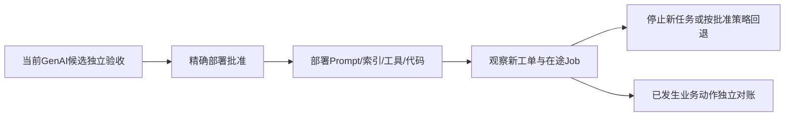

# 21 · GenAI 客服业务强化、企业验证包与平台扩展

实现状态：`NOT_STARTED`。当前主线为 **Enterprise GenAI Release Verification & Governed Coding Harness**；被测业务限定为B2B SaaS续费退款争议的处理建议与客服草稿。合成Tenant、账单、政策和合同例外用于实验；真实付款、客户通信、企业数据和生产推广均另行准入。

首期前置为05–09真实实验、批准的SUP规则和独立Oracle，以及10–14执行链。后续工作按[18价值评估](18-evaluation-and-pilot.md)的证据选择；不是为了展示完整产品先建设所有客服功能。旧ML和Eventuate保留历史，重新启用需重新建立资格。

## 1. 从业务需求选择扩展

| 需求 | 应扩展的部分 | 新验收证据 |
| --- | --- | --- |
| 新政策/工具Schema发布 | GenAI manifest、ContextBuilder、SUP-01/04/07/08 | 新行为与历史兼容同时成立，正确候选可无修复通过 |
| 工单多轮更新和Worker重试 | SUP-05/06、revision/fencing、Job派发协议 | 旧结果不覆盖新工单、重投净效果一致、草稿提交后完成 |
| 客服自然语言质量 | 独立Semantic Evaluation Profile | 人工校准rubric、数据切片、重复/统计策略、误判与不确定报告 |
| 多Agent handoff与客户升级 | Handoff工具及上下文合同 | 身份、证据、待办与权限传递完整，有限循环和明确责任 |
| 自动发送/退款 | 独立业务Action Gateway和人审 | 准确客户/账单/金额/动作批准，撤销、未知和重复效果对账 |
| 企业接入与多租户 | Connector、身份和Verification Pack生命周期 | 当前ACL、历史政策、区域/保留及越权否定测试 |
| 第二业务或新模型provider | 独立Profile/Adapter与模型通道 | 同平台协议下独立健康/变异对照及公平成本报告 |

新需求先形成Owner确认的RequirementDelta和版本化Profile。不存在“换成真实LLM就自动取得企业能力”的推导。

## 2. 首期发布切片：新政策与Tool Schema

V3.4/V4.0为自有实验标签，不代表开源Demo版本或真实线上稳定史。参考OpenAI航空客服Demo的Agent/tool编排；SaaS账单、政策生效日期、租户权限、持久Job/草稿由本项目显式建设。引用来源与我方扩展必须分别记录。

1. Stable具备已声明的十月政策处理能力和可信观察。首轮固定LLM及Worker，正确V4新增十一月政策和tool schema v2，保持历史续费事件适用性。
2. CS-1042的续费日为2026-10-25，工单日为2026-11-02；政策按续费事件选择。使用与合同证据缺失时只能NEEDS_MORE_EVIDENCE，建议HUMAN_REVIEW或REQUEST_INFORMATION，不能仅因14天窗口断言可退款。
3. 同时准备完整证据下ELIGIBLE/INELIGIBLE样本，防止一律转人工通过；日期边界、时区、窗口含端点和合同优先级由06明确，测试时钟冻结。
4. 正确V4、latest-policy-only和ticket-date-as-renewal-date分别校准；人工变异标SYNTHETIC_MUTATION。隐藏答案、正确参考实现和精确逆补丁不能进入Coder/Planner挂载。
5. Final同时覆盖十一月新需求与十月兼容。回退Stable删除新功能、改业务政策或放宽Oracle均不构成修复。正确V4无Coding仍为CHANGED合格候选，不能标NO_CHANGE。
6. 主评估RELEASE_VERIFICATION、DISABLED、FINAL_ONLY；真实修复与Draft PR/CI另按授权及资格开展。

API smoke只是接口/序列化校准。真实LLM、工具Trace、政策Oracle和对客质量分别取得证据；来源冻结不等于健康SaaS基线。

## 3. 扩展A：工单版本、并发与持久性

Job绑定tenant、ticket_id、ticket_revision及GenAI release引用。工单更新产生新revision；旧Worker迟到提交须被条件写/版本约束拒绝，不能覆盖当前草稿或把新工单变成RESOLVED。保留旧attempt及其结果用途，不能删掉历史掩盖冲突。

明确同key同payload、不同payload、不同revision、取消/重新打开工单的复用或拒绝规则。HTTP幂等键只标识请求；工具调用与供应商模型请求另有身份。provider不支持幂等或查询时承认重复调用/费用可能性，不以本地去重证明远端恰好一次。

若承诺202受理后可恢复，SUT先持久登记Job与待派发记录，再经Redis通知Worker。草稿写入和Job DONE在同一业务事务中提交；队列确认在提交后。EGAP数据库和SUT数据库分域。持久性仍须定义宿主/存储故障范围，事务存在不能代替备份或零丢失证明。

故障矩阵覆盖：派发前后退出、provider已接受响应丢失、工具完成但草稿未写、草稿提交后确认前退出、旧revision Worker迟到、两个Worker竞争、取消后迟到响应、DB和Redis分别不可用。屏障应确认实际命中，不能用sleep猜窗口。

扩展文件拟放`registry/packs/saas-support/`、`packages/oracles/src/support/`及`tests/integration/support-recovery/`。每项有独立fixture/reset、正反控制、清理回执和旁观对象不变证据。

## 4. 扩展B：回复质量、切片与性能

Semantic Profile冻结rubric、任务/答案边界、标注与复核方式、provider/model/config、重复策略、统计方法、阈值及不确定处理。关键政策/权限/金额/日期事实优先由确定性Oracle核验；引用真实但不支持正文结论仍可构成语义问题。

开发集用于调试，holdout由独立评估方控制。公开的演示缺陷只用于校准；正式价值评估另用隐藏任务组合，不把已公开答案称盲测。grader不能以Coder解释或自证测试作为真值，也不能覆盖确定性FAIL/INCONCLUSIVE。

切片可按套餐、政策版本、合同例外、证据完整性、语言和租户权限定义，须有业务理由。生成文本不要求逐字相等；评估错误承诺、遗漏、清晰度及人工修改成本，不能只报告平均流畅度分。

性能分排队、检索、工具、LLM、持久提交和端到端；计入SUT模型、Verifier、Grader、Coder、环境与重试。相同模型名称跨日期不证明同一权重；记录实际返回身份，重复策略在运行前冻结。没有批准质量门槛时保持“草稿待人工审核”的范围。

## 5. 扩展C：Handoff、业务动作与生产推广

Handoff不是把一段对话发给另一个Agent即可完成。合同明确转交主体、tenant/ticket/revision、证据、待补信息、责任人、允许工具和终止条件。接收方重新授权，不继承发送方任意能力；跨团队队列可能失败/重复，需要可恢复交接记录。

退款与对客发送使用SUT独立业务ActionIntent/Approval，绑定客户、账单、金额/货币、消息正文、动作和期限。EGAP CREATE_DRAFT_PR批准只授权代码交付，不授权业务动作；SUT业务批准也不能用作代码发布许可。首期沙盒拒绝路径不等同完整真实退款资格。

推广与回退绑定完整GenAI manifest。旧Job继续使用哪一版、紧急撤销后是否停止、旧索引/政策保留多久必须明确；不能运行中悄悄换Prompt或模型。回滚代码无法撤销已发送回复或退款，未知结果先对账。

## 6. 扩展D：公司专属Verification Pack与第二系统

Pack最小闭包包括：Business/Service/Verification/Acceptance/Environment Profile、ContextBuilder映射、受控工具与Oracle版本、实验模板和数据引用、适用性与权限、依赖兼容及资格。Pack内容批准、安装解析、激活与撤销分开；模型不能动态注册工具或修改mandatory。

1. 选择明确Owner和可重建环境的第二业务；先写真实业务规则，不能复制当前退款答案。
2. 实现prepare/health/act/observe/cleanup与领域ContextBuilder；无能力字段写UNKNOWN或不支持。
3. 对正确/单缺陷/坏观察完成校准，再复用Runtime、Verifier提案接口、Final与交付。
4. 接入成本包括Adapter、Oracle、权限、数据与Owner决策；两案例不证明任意企业零改造接入。
5. 保持当前Support Pack回归；历史ML/Eventuate恢复时重新准入，旧来源/编译/mock结果不成为业务PASS。

首期只做一个显式注册Pack，不建设任意代码热加载平台。增加embedding/reranker/托管向量库前先证明现有检索瓶颈及收益，来源ACL和删除语义不能因换检索引擎放宽。

## 7. 多Run、升级与退役

先验证两个独立环境的端口、fixture、SUT DB/Redis命名空间、工具/模型capability、语料索引、证据与预算互不串用，再按CPU/内存、provider配额和尾延迟扩并发。企业租户隔离另执行19/20/94，不能用合成A/B租户样本宣称全部生产隔离。

代码、Prompt、语料、检索、工具、provider配置、Oracle、grader或Runner变化产生新revision，并使相关资格重新核验。只复核受影响资格及必要基线，不覆盖历史证据，不为每个候选机械重跑全部Stable。

退役：关闭新准入和业务动作 → 排空或明确取消在途Job/Run → 对账外部效果 → 保存获准证据 → 撤销能力和密钥 → 按期限清理。UNKNOWN移交责任人；模型/日志/索引/备份各自删除回执，不能删账本制造完成。

## 8. 每个扩展的完成标准

- [ ] 业务Owner、需求、版本化Profile、范围和非目标明确。
- [ ] 健康、变异、坏观察与旁观对象对照真实运行。
- [ ] 旧范围回归、新权限、数据流和成本可解释。
- [ ] 结果说明语义质量/确定性正确性/动作权限各自资格。
- [ ] 有指标、残余风险、继续或停止决定及回退方式。

报告拟放`reports/21-extensions/<extension-id>/<run-id>/`，原始对象进入受控ArtifactStore。所有路径是计划，不表示当前存在实现。后续更新docs仍需明确许可。

历史治理来源：[v3 第31、35–36、45节](../../EGAP-Order-Approval/docs/eventuate-production-plan-v3.md)；订单和ML映射在93保留历史，不能直接替代SUP合同。
