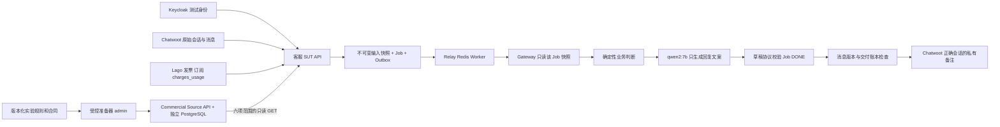

# Business Source Pack v1 实施与验收报告

日期：2026-11-10（Australia/Sydney）。本轮完成用户附件提出的实验商业上游最小交付，保留真实 Chatwoot、Lago、Keycloak、本地 qwen2:7b 与现有异步 SUT。本文记录实现和实测结果；没有修改冻结的 `docs/**` 或项目 README。

**结果：客服产品已能读取实际商业来源 API，形成符合、不符合和补证三类结构化建议，并写入正确会话的私有备注。最终真实联调 46/46 断言通过，7 个 LIVE_MODEL Job 全部 DONE。** 本结果是本地业务校准，不是 EGAP 最终 PASS、正式企业退款批准或生产发布资格。

## 1. 业务上究竟补了什么

原流程能证明“正确的人查询了正确的账单，并收到了草稿”，但真实路径政策、合同与续费时间为空，资格固定补证。本轮增加决定资格需要的来源，仍由被测客服产品自己计算决定。

| 问题 | 本轮实现 | 不混淆的边界 |
|---|---|---|
| 应该按哪版政策 | `lab-v1` 14天、`lab-v2` 7天；按续费生效时间选版本 | 申请发生在新政策发布之后，不自动改用新政策 |
| 客户适用什么合同 | 标准、特殊、未成立三种合同原文和结构摘要；原文 SHA-256 绑定 | 文档存在不等于已接受；特殊条款首期转人工 |
| 何时续费 | 第一期间开通→推进独立业务时钟→第二期间续期事件 | 发票生成、首次购买、终止均不等于续期 |
| 何时申请 | `RefundClaim` 固定 `claimed_at` 与原始消息引用 | 补充消息增加修订，不移动起点 |
| 用量是否可信 | 指定指标/单位/订阅/期间；expected/sent/received/原生聚合核对后封存 | 空响应不是0；整账期用量不是任意子区间用量 |
| 是否付款 | 单独 `SIMULATED_PAYMENT`；发票、币种、金额精确匹配 | 没有修改 Lago 付款状态，没有真实支付商 |
| 新证据如何生效 | 显式 `reevaluate`，新 Job、新快照、父 Job、原因和事实摘要 | 普通重试保留原结果，旧快照不能覆盖 |

实验规则由本轮实现定义为 `LOCAL_CALIBRATION`；人工政策审阅仍是 `PENDING_USER_REVIEW`。没有伪造用户、财务、法务或客户审批记录。

## 2. 这一套系统怎样连接



商业来源返回条款、事件与资料状态，不返回“此案例应该符合”的答案。模型不能填写资格、动作、政策引用或证据引用，这些结构字段由产品计算后组装。校准器自己的预期只留在测试侧。这里的确定性产品判断依然是未来 Verify Agent 要检查的对象，不能把它当独立 Oracle。

## 3. 政策与合同文件逐项说明

新增根目录 `business-source-pack/v1/`，它是此次明确要求的业务输入资产，不替换既有设计手册。

| 文件 | 内容与用途 |
|---|---|
| `SPEC.md` | 总体实验规则、来源边界及人可以手算的校准样本。含测试预期的样本表不发送给 SUT。 |
| `policies/rules.md` | 可发送给来源服务的规则原文，不含案例答案表。 |
| `policies/lab-v1.json` | 14×86400秒，适用区间 `[2026-10-01, 2026-11-10)` UTC。 |
| `policies/lab-v2.json` | 7×86400秒，适用区间从2026-11-10 UTC起。 |
| `contracts/standard.md` | 合成订单表和 `EGAP-LAB-REFUND-1` 补充条款，明确本地退款例外、客户/订阅/有效期及政策选择。 |
| `contracts/special.md` | `EGAP-LAB-SPECIAL-1`，明确标准规则不直接决定资格，首期人工处理。 |
| `contracts/incomplete.md` | DRAFT，未记录接受，没有有效退款补充条款。 |
| `upstream/common-paper-csa-2.1.html` | 固定版本公开原文副本，用于追溯，应用不执行其中脚本。 |
| `upstream/provenance.json` | 原文 URL、作者、CC BY 4.0、下载日期、SHA-256、修改说明。 |

选择固定 [Common Paper CSA 2.1](https://commonpaper.com/standards/cloud-service-agreement/2.1/)；其标准条款4.1并非默认“14天无使用即可退”，所以实验例外明确写在单独补充条款中。没有混用其他模板或把公开条款称为已签企业合同。

结构摘要保留 `source_document.reference/text/sha256` 与 `structured_source_sha256`。SHA只能证明绑定的文本未变，不能证明法律解释正确或已经有人批准。实验接受记录固定标记 `SIMULATED_ACCEPTANCE`。

窗口按 UTC 经过秒数计算，0和末端包含；合同有效期左闭右开，而且在续期和申请两个时点都必须有效。用量检查闭区间“续期生效→原始申请”，指定 `metric_code` 与 `units`，允许上限为0。

## 4. 新商业来源服务逐文件说明

目录：`services/commercial-source/src/commercial_source/`。

| 文件 / 核心符号 | 实际职责、失败和副作用 |
|---|---|
| `__main__.py` | 读取0600私有配置、迁移自有 schema、绑定 loopback 动态端口、输出 READY 回执、租期到期退出。 |
| `server.py:create_app` | `GET /health/ready`、`POST /v1/commands`、`GET /v1/context`；分别校验角色、租户、体积、重复字段与有效租期。 |
| `protocol.py:Settings` | 管理与读取 token 必须不同；私有配置不能是软链接；只接受本地实验权威。 |
| `protocol.py:parse_command` | 命令封套为 `operation_key/type/payload`；拒绝资格答案和伪造 approved 字段。 |
| `protocol.py:source_document` | 校验原文与结构摘要指向同一内容散列；接受本地校准或待审阅状态，不制造企业批准。 |
| `store.py:CommercialStore.execute` | 租户行锁、命令摘要、幂等操作账本与业务变更同一 PostgreSQL 事务提交。同 key 同命令返回原结果，变参数409。 |
| `_asset` | 新增不可变政策/合同版本；已有版本不能改写。 |
| `_activate/_advance/_stop` | 开通、单调推进业务时钟、取消续期、终止；第二期起才产生续费事件。固定秒数周期不冒称自然月调度。 |
| `_link` | 根据真实发票详情核对客户、唯一订阅和费用期间，严格等于商业事件期间；终止发票不能关联成续费。 |
| `_claim/_supplement` | 固定申请受理时刻、原消息ID/真实创建时刻/正文散列，补充只追加、不得篡改。 |
| `_coverage/_usage/_reconcile/_seal` | 管理有限预期集合、发送/接收回执、指定指标原生聚合核对；未齐、未校准不允许封存。 |
| `_payment` | 持久保存明确模拟的付款事实，不能覆盖原付款记录。 |
| `context` | REPEATABLE READ + READ ONLY 一致快照；完整范围返回事实或 null，不读 SUT 数据表。 |

自有 schema `egap_commercial` 只有三张通用持久表：`tenants` 保存来源 revision，`records` 保存带类型/对象/版本的领域记录，`operations` 保存幂等请求与原响应。首期采用 JSONB 减少迁移复杂度；身份、状态转换和校验仍在事务内明确实现，不是静态 JSON fixture。

命令包括政策/合同登记、开通、推进时钟、取消、终止、发票关联、申请/补充、覆盖开启、用量发送/接收/核对/封存和模拟付款。SUT只有读取 token，不拿管理员 token或来源数据库口令。

## 5. 实验宿主与准备器

`tools/commercial-source.py` 创建本实验独立 PostgreSQL 容器/卷、writer/reader/testwriter与两个数据库。reader只能SELECT，writer与testwriter不能跨到彼此数据库。`up/status/stop/start/down` 校验实例ID、资源标签、容器ID、PID/启动签名、源码摘要与租期；`stop`保留卷，`down`只删除该实例登记的资源。依赖复用项目现有锁定 Python 环境，没有新增第三方依赖安装。

`tools/multi-system/sut.py` 增加 `--runtime --bindings --output-directory --commercial-config`。商业配置只投影读取 token、租户范围、实例/API/源码摘要和到期时间，拒绝把管理员配置误传SUT。来源实现摘要独立于候选代码摘要。

`tools/multi-system/seed.py` 增加显式 `--align-current-period`。通过 Lago 的 `subscription_at` 在当天 UTC 零点开通，使当前用量期间与首张订阅费用期间严格一致；不修改系统时钟，也不修改原始用量响应。旧默认模式保留，恢复时不能偷换期间模式。

`tools/multi-system/business_source.py` 新增两个入口：

- `prepare`：原生 API 读取→冻结准备回执→通过商业来源命令创建对象；在本地保存首次完整命令，未知回执同 key 重试，参数变化明确拒绝。准备账本绑定原生seed散列、来源实例和源码摘要。
- `check`：实际 Keycloak 登录→SUT提交→等待真实Worker/模型→读回Chatwoot备注→直接只读审查实验快照。显式校准答案只在这里。因为会添加付款和消息，使用原子启动标记防止重复执行覆盖旧报告。

历史政策案例有明确日期前置条件：续费须发生在固定v2切换点之前，申请在之后。未来换日期生成新原生样本时，驱动可能返回 `HISTORICAL_POLICY_CALIBRATION_DATE_UNAVAILABLE`，届时应另建合适的版本化实验资料，不能偷偷移动历史政策。

## 6. 客服 SUT 改动与真实调用关系

目录：`services/genai-support-sut/`。

| 文件 | 改变了什么，为什么 |
|---|---|
| `src/genai_support/integrations/commercial.py`（新增） | `CommercialClient.context` 读取六项范围：租户、客户、订阅、发票、账号、会话。`commercial_decision/_assess` 执行资格规则；缺项补证、特殊条款人工处理，资料充分才判符合/不符合。配置来源失联会失败，不回退fixture。 |
| `integrations/lago.py` | 归属确认后取得唯一订阅、真实费用期间。历史用量按发票ID与期间绑定；当前用量只有精确同期间才允许显式 `SUBSCRIPTION_CURRENT_PERIOD`，保留原生空发票ID。 |
| `integrations/workflow.py` | 受理时收集商业来源、固定claim时点、选中政策与合同；新增显式刷新；私有备注增加确定性实验范围声明。 |
| `integrations/persistence.py` | 新快照、Job、Outbox、父Job及刷新原因原子提交；稳定事实投影排除观察时间、全局revision和不适用政策，保留真正影响决定的事实。 |
| `integrations/routes.py` | 新增 `POST /integrations/disputes/{tenant}/{job}/reevaluate`，body严格为 `operation_key/reason`；继续经过OIDC与归属校验。 |
| `migrations/003_commercial.sql`（新增） | 输入新增 `assessment_facts_sha256/assessment_source_revision`；操作新增 `parent_job_id/reevaluation_reason`及索引；兼容旧行，不覆盖旧快照。 |
| `business_tools.py` | 文案输入剔除商业原文和原客户消息，保留所选摘要和决定；完整原文仍在快照。scripted校准也带实验标签，但LIVE不调用scripted替身。 |
| `model_gateway.py` | 提示明确实验规则、模拟付款及不支持的特殊条款；prompt版本更新为`support-commercial-source-v3`。模型仍只产生文案。 |

核心顺序：

```text
routes.submit
  → DisputeService._submit
  → Keycloak + server binding
  → Chatwoot messages + LagoClient.resolve_invoice_scope
  → CommercialClient.context
  → commercial_decision
  → IntegrationStore.admit（快照+Job+Outbox）
  → 既有Relay / Redis / Worker
  → ResolutionGateway.resolve
  → ExternalSnapshotTools.collect（只读该Job快照）
  → external_decision / commercial_decision
  → model_reply_context → qwen2:7b → assemble_draft → schema校验
  → Job DONE → deliver检查当前消息/版本 → 私有备注及读回对账
```

`normalized_lago_usage` 从 `charges_usage` 取唯一指定指标，使用 Decimal；不读顶层 `units`，不混加其他指标。`_coverage_units` 核验预期/发送/接收集合、原生整期聚合及其范围，再按业务事件明细计算申请子区间；全期11不自动等于申请前11。完整性明确限定 `LOCAL_CONTROLLED_GENERATOR_ONLY`。

刷新语义：原key重放原Job；新普通key、同消息同发票也复用原Job；只有显式refresh才因商业事实变化新增评估。无新事实返回同Job；有新事实保留父关系与新快照。并发在操作键/工单锁内比较，版本已前移的冲突返回409。

## 7. 本轮真实案例与验收结果

最终来源目录：`artifacts/business-source/bsp-v1-20261110-final/`。沿用同一批真实原生对象的不可变seed副本，商业服务和SUT使用新实验身份。原生对象通过API创建，不写Chatwoot/Lago/Keycloak数据库。

共同原生费用期间为2026-11-09 00:00:00至2026-12-08 23:59:59 UTC。模拟器从前一个相同秒数期间推进至第二期，其期间与发票严格相等。**真实Lago发票仍是首次开通发票；映射到模拟第二期不代表Lago原生自然续费已验证。**

| 实际链路 | 输入变化与手算依据 | 最终结构结果 |
|---|---|---|
| a_zero首次 | 标准合同，11月9日模拟续期，11月19日申请，0用量覆盖封存，但无付款事实 | NEEDS_MORE_EVIDENCE / REQUEST_INFORMATION |
| a_zero显式refresh | 增加同发票、USD、12000分模拟付款；10天≤历史14天 | ELIGIBLE / HUMAN_REVIEW，新Job和新快照 |
| a_zero补充消息 | Chatwoot实际追加incoming；商业claim追加引用，原申请仍11月19日 | ELIGIBLE，新revision；旧快照散列不变 |
| b_zero | 11月24日申请，距续期15天；其余标准资料充分 | INELIGIBLE / NO_ACTION |
| a_used | 原生charges_usage=7，但来源覆盖OPEN，缺发送/接收与校准证明 | NEEDS_MORE_EVIDENCE，明确USAGE_COMPLETENESS |
| b_used | 特殊合同条款，另存在同客户DRAFT文档；覆盖仍OPEN | NEEDS_MORE_EVIDENCE / HUMAN_REVIEW，明确SPECIAL_CONTRACT_TERMS |
| a_closed | 原生终止账单和历史11 units，没有正常续费事件 | NEEDS_MORE_EVIDENCE；renewed_at保持null |

7个Job全部DONE，7次模型调用均有COMPLETE回执；7份私有备注逐一读回，客户公开消息未发送，会话未关闭。用量不足与特殊条款结果验证了具体缺项，未仅靠同一个NEEDS_MORE_EVIDENCE标签判断通过。

真实读取账本：122条外部观察，其中9次商业来源读取；7份不可变输入快照、2条新评估父关系、14条网关工具事件。最终来源42条命令：4个政策对象（两版本×两租户）、5份合同（3标准+1特殊+1草稿）、4订阅、8生命周期事件、4claim、4覆盖记录、4发票关联、4模拟付款。

本地模型`qwen2:7b`：最终成功实验使用7/24调用预留，观测17,324输入token、403输出token，共17,727。首个失败校准另有一次模型调用；不将它混入最终7次，也不从成本/失败记录中抹除。没有外部模型费用声明。

## 8. 验证清单与证据位置

| 层次 | 实际结果 | 范围 |
|---|---|---|
| SUT主测试集（补投影专项前的全量批次） | 181/181，0跳过 | 包含真实专用PG/Redis、刷新并发、历史政策、窗口端点、合同双时点、用量、精确付款、协议引用。 |
| 模型输入投影专项 | 2/2 | 大合同和消息指令不进入文案上下文；原输入不被修改；scripted实验标签。 |
| 商业服务 | 20/20，0跳过 | 真实PG及loopback HTTP，角色、幂等、回滚、取消/终止、claim、待处理用量与校准封存。 |
| 多系统工具 | 27/27 | seed7、SUT准备5、商业准备/证据保护15。 |
| 商业宿主 | 12/12 | 身份、签名、源码漂移、恢复门禁和精确资源边界。 |
| 新来源DB权限 | 6/6 | reader SELECT、拒写/DDL、source与test数据库互相隔离。 |
| 实际宿主生命周期 | 8/8 | 独立临时实例up→stop→start保留数据/身份/端口→down精确清理。 |
| 最终真实E2E | 46/46 | 上述7个真实模型Job、只写私有备注、刷新和追加消息。 |
| TypeScript/Python协议 | 一致 | `pnpm check:support-protocol`构建并核对共享schema快照。 |

SUT的181项与随后新增的2项投影测试分批执行，合计183项已执行测试；投影日志为 `validation/model-projection-2-tests.log`。

新增测试主要在 `services/commercial-source/tests/test_commercial_source.py`、SUT的`test_commercial_decision.py`与`test_commercial_model_projection.py`、`tools/multi-system/test_business_source.py`、`tools/test_commercial_source_host.py`；既有连接器、账本、路由和准备器测试同步扩展。

最终目录主要文件：

- `integration-check.private.json`：每条断言、7个Job与实际API回执。
- `source-preparation.private.json`：完整首次命令、回执、来源身份、业务计划。
- `postcheck-audit.json`：最终数据库只读计数、模型回执及预算。
- `native/seed.json`、`native/seed-state.json`：原生对象与首次写入账本；补充消息也有原生写入记录。
- `sut/sut.json`：当前SUT身份和安全定位信息。
- `ready.json`、`database-permissions.json`：来源身份和权限校准。
- `validation/`：本轮测试日志、宿主生命周期和权限报告副本。

凭据及原始业务对象留在ignored artifacts且0600，不进入Git。本报告、脱敏summary和代码可以同步仓库。

## 9. 联调发现的错误与修复

1. **首个真实Job协议失败**：商业文档路径带`/`与`#`，不符合草稿`evidence_refs`的标识符约束。修为`lab-doc:<sha256>`，原文路径仍保留快照，并补完整draft schema回归测试。没有放宽通用协议。
2. **特殊合同原文与摘要编号不一致**：准备器改为`EGAP-LAB-SPECIAL-1`。旧资产不可覆盖，使用新来源实例重新登记；旧实验标FAILED并保留。
3. **金额匹配过宽**：从“大于等于”改为严格相等，增加不足、超付、错币种、无效金额类型测试。
4. **观察元数据制造新评估**：稳定投影排除无关变化，保留真正业务时点/值/适用政策歧义；比较旧快照时重算同一投影，不覆盖旧原文或摘要。
5. **准备器恢复静默采用旧payload**：新增参数摘要冲突、实验身份绑定、明确日期前提及失败状态持久化；验收启动标记防止覆写首次证据。

旧失败SUT `environment_262b5b9f-e704-4f29-b293-b67ec762d82d` 已停止，旧商业来源 `commercial_c0bfa46cee8d4135ae8a5cb0ed698ab7` 已停止，数据库/卷/证据保留。11月9日旧SUT也按签名停止并保留，三套原生产品仍运行。

## 10. 必须如实保留的限制与下一步

- 仍为本地合成商业资料：没有真实客户签约、公司政策批准、真实支付商或真实团队采用。人工政策审阅尚待用户确认，不能编造review_record。
- 本轮验证的是模拟状态驱动续期与真实账单的精确映射，未验证Lago v1.57.0自然跨期调度。取消/终止状态机与窗口边界由协议/真PG测试覆盖，并非全部都跑了原生Lago周期。
- 本轮a_used是“已看到7，但资料链未补齐”的真实集成缺证；待处理事件阻止封存及补齐后的核对由真PG测试验证，**尚未完成真实Lago延迟事件到达并恢复资格的E2E**。有限生成器覆盖不是企业全部事件完整性证书。
- 当前current_usage支持严格同期间且唯一指标；多指标分组、分段收费、多个订阅同发票、自然月/时区复杂规则需各自扩展。固定历史日期校准不是任意日期一键重放。
- 商业来源命令是受信准备器接口，目前有顶层封套和领域检查及答案字段拒绝；还不是每个命令的完整字段白名单。未来接真实企业上游应补严格schema和全链路来源身份约束。
- 草稿结构和权限边界已测试；**自然语言回复质量尚未获得独立业务Oracle批准**。抽查发现模型在缺付款时写过“似乎符合退款标准”，部分原始文案未主动写出实验标签。最终私有备注由确定性包装补上“本地实验/模拟资料”范围，不对客发送。这正是后续Verify Agent应发现的语义风险，不能把Job DONE当作语义PASS。
- source/service与SUT在同一台主机同一操作系统用户下运行。HTTP凭据与DB角色分离已验证；恶意候选进程的OS级不可读/不可改隔离、受保护Oracle、证据签名和正式发布门禁尚未完成。
- `reevaluate`同key重放保留正确Job身份，但响应附带元数据未完全复现首次响应；外部来源任意ID与草稿标识符的统一约束仍需扩展，目前受控生成ID已校验通过。
- Verify Agent/LangGraph规划器、Codex候选修复循环、受保护Final、人工发布批准和企业Connector本轮没有实现。下一项适合选一个窄变更：例如“支持特殊合同例外”或“修复缺证情况下的误导性回复”，让独立Verifier根据此来源包提出有针对性的实验与反例。

建议阅读顺序：`SPEC.md` → `business_source.py:prepare_case` → `CommercialStore.execute` → `DisputeService._submit` → `commercial_decision/_coverage_units` → `IntegrationStore.admit` → `BusinessCheck.run`。这样先理解一个业务案例如何生成，再理解产品判断和独立校准如何衔接。
