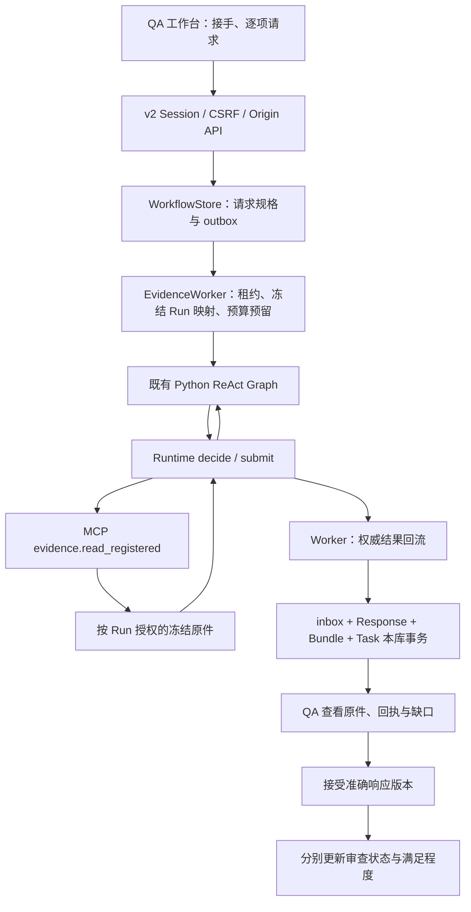

# QA 补证与 Agent 回流实现报告

日期：2026-11-19。起点：`d0e850b95fb9ca7865855dbbc8b28c71112c46f1`。

本轮实现了 **任务接手 → 逐项补证 → 同一 ReAct Graph → Runtime → MCP 读取历史原件 → 版本化响应与 Bundle → QA 限定接受**。真实本地模型在修正后的两个已知归档任务上完成了该链路。完整浏览器点击验收仍受工具错误阻塞，因此本报告不将整个产品切片标成全部验收完成。

`docs/**`、项目 `README.md` 没有修改。旧 v1 ACK 与历史记录没有被转换为新任务接手或批准。本轮模型验收在独立测试数据库完成，自动化 QA 接受不代表用户作出了业务决定。

## 1. 已实现的业务行为

| 用户动作／情形 | 实际行为 |
|---|---|
| 同一 QA 处理两类问题 | 两项独立义务：`EVIDENCE_LINKAGE`、`SEMANTIC_REVIEW`；角色只决定资格 |
| 接手 | 更新本任务版本，不完成审查、不授予发布权限 |
| 转派 | 更新 assignment revision；旧负责人不能再接受，已有取证可继续；新负责人先接手 |
| 请求补证 | 按目标 Job、ticket、revision、阶段逐项请求，冻结输入、来源包、材料索引和审查规则 |
| Agent 响应 | 每项列 disposition、原件引用、实际读取回执、行区间和缺口；服务端验证后登记 |
| 接受响应 | 绑定请求规格、响应 ID／摘要、任务／归属版本、当前审查包、候选与规则版本 |
| 原件未归档 | 可以接受准确的缺口说明，但 fulfillment 仍为 UNAVAILABLE，义务继续未满足 |
| 局部原件齐全 | 单个请求可 COMPLETE；全案关联义务要求 4 个目标 × 3 种核心原件，不能用局部接受关闭 |
| 业务语义 | 原件关联通过不代表退款资格或文案正确；本轮不自动完成语义审查 |
| 失去网络后刷新／重登 | 未决命令按身份、任务、动作保留；不自动重发，只能显式重放原 payload 和 idempotency key |

执行状态、响应审查状态、请求满足程度分别保存。任意客户端自定义的 `acceptance_criteria` 不会变成已实现的门禁：本切片仅接受对应冻结模板；`goal` 是调查说明。

## 2. 真实接入的材料

固定历史实验 `egaplate20261119a`，产品候选 `45a0378585b8970fb2860897c9e49792e15a9df0`，租户 `tenant-b`。

两种场景 `late_usage`、`post_claim_usage`，每种 `before/after` 两个阶段，总计 4 个准确 Job／ticket revision 目标。归档导入器核对固定文件 SHA-256、候选、历史运行、租户、Job、ticket、阶段，以及消息 ID 与 private 标记，登记 12 份材料：

- `SAVED_PRODUCT_DRAFT`：已保存客服草稿。
- `DELIVERED_PRIVATE_NOTE`：准确最终私有消息的正文及身份。
- `DELIVERY_RECEIPT`：同一 Job 到准确消息 ID、备注引用与摘要的交付关系。

`RAW_PROVIDER_RESPONSE` 没有归档，不能由保存草稿重建。材料内容保留历史 `observed_at`，Bundle/响应表另记本次创建时间。原件正文和模型原始输出留在私有本地存储；此报告只发布脱敏结果。

## 3. 实际调用链与阅读入口



| 文件 | 本轮职责 |
|---|---|
| `apps/review-workbench/src/main.ts` | 启动 v1/v2 schema、固定归档登记、Web；页面 GET 不调用 Runtime 对账 |
| `apps/review-workbench/src/workflow-types.ts` | 人员命令版本、请求、Run 映射、预算与结果桥接契约 |
| `apps/review-workbench/src/workflow-store.ts` | 任务／归属、补证、精确接受、Bundle 合并、outbox/inbox、累计预算与澄清 |
| `apps/review-workbench/src/workflow-routes.ts` | 复用服务端身份的 v2 API，不接受正文伪造 actor |
| `apps/review-workbench/src/evidence-archive.ts` | 固定归档来源校验、字段允许清单、精确对象关联 |
| `apps/review-workbench/src/evidence-mcp.ts` | 受限 MCP HTTP 服务、冻结材料注册和真实读取适配器 |
| `apps/review-workbench/src/evidence-worker.ts` | 稳定凭据、同一 Graph、事务外执行、心跳、结果回流与只读恢复 |
| `packages/contracts/src/evidence-review.ts` | v2 输入／响应／动作、摘要和严格校验，保留 v1 发布任务要求 |
| `protocols/verify-agent/v2/` | 跨 TS／Python 动作 Schema 与一致性样本 |
| `packages/verify-runtime/src/evidence-profile.ts` | 证据上下文、可行动作 Schema、引用／类型／范围／交付关联门禁 |
| `packages/verify-runtime/src/runtime.ts` | 同一权威模型账本和动作准入，READ 短事务领取、事务外 MCP、短事务登记 |
| `services/verify-agent/src/verify_agent/graph.py` | 同一 Graph 消费读取结果，识别证据响应及在途动作，不直接写工作台 |
| `apps/review-workbench/public/app.js` | 真任务、接手／转派、逐项响应、原件／回执、接受／撤回／澄清及未决命令恢复 |
| `tools/review-evidence-live.mjs` | 两项有界真实模型验收；独立测试库；不替用户签署 |

关键入口和事务／权限／预算分支已补中文注释。

## 4. Agent 与 MCP 的真实边界

`EVIDENCE_REVIEW` 不虚构 baseline 或 diff，也不放宽旧发布模式对 reports/artifacts 的限制。新模式使用独立归档来源类型，同时绑定历史运行和产品候选。

首轮真实模型暴露了两种错误：未读取就引用原件、为缺失的 provider 响应读取无关材料。门禁拒绝了这两类提案；随后增加共享的动作可行性计算：

1. 根据请求的精确类型与目标选择相关原件及必要交付依赖。
2. 原件未读完时，生成 Schema 不提供提交响应动作；模型仍可选择相关 READ 的顺序、CLARIFY 或 STOP。
3. 没有匹配归档的项目允许准确报告限定范围的缺口，不提供无关 READ。
4. 响应中的 item、材料、回执及位置只取当前登记值；独立服务端门禁仍再次校验。
5. 模型负责解释和提出响应；Runtime 不能据此批准业务，QA 接受仍由独立人员命令完成。

MCP 首版实际提供 `evidence.list_registered` 与 `evidence.read_registered`。采用固定 `2025-06-18` 的受限 Streamable HTTP JSON 通道，支持 initialize、tools/list、tools/call；不支持 SSE，GET 返回 405。此实现依据 [MCP 传输规范](https://modelcontextprotocol.io/specification/2025-06-18/basic/transports) 和 [Tools 规范](https://modelcontextprotocol.io/specification/2025-06-18/server/tools)，不是任意 MCP 服务的完整通用客户端。

任务上下文由 Workbench 冻结输入提供；本轮没有额外声称实现 `review.get_task`、`review.list_effective_decisions` 或 Agent 人工接受工具。响应提案只经过 Runtime 的同一受控动作入口，之后由可信 Worker 回流。

## 5. 恢复、并发与预算

- 两个独立数据库不承诺跨库原子提交。工作台自己的 inbox、响应、必要 Bundle、任务和事件在一个事务中提交。
- 请求规格绑定 Run、输入摘要、配置、limits、凭据引用。重复消费与租约恢复复用它们；不生成新 token 绕过旧运行。
- 父 Case 保存已消费和预留额度，初始上限为 24 次模型调用、48 次读取。当前 Worker 单请求预留 6 次模型调用、4 次读取。超额会阻塞；这不是无限循环。
- UNKNOWN 保留全部预留；只读对账不能派发模型或 MCP。Runtime 已有确定终态而回流失败时，可以沿同一 Run 恢复；真正未决的外部调用仍为 UNKNOWN，当前没有自动 provider 对账服务。
- 模型与 MCP 调用前后重检执行授权；转派不等于撤回。撤回／范围失效的迟到结果只归档。
- Runtime 事件序单调处理，旧状态不能让 FINISHED 或已接受响应回退。旧事件与成本仍可审计。
- 新 Bundle 将验证后的增量合入当前 manifest；不会用旧包覆盖并发新增材料。重复材料不多造版本；冲突保留。
- 澄清生成后继请求规格／Run；保留前次 Run、读取引用、缺口、回答和累计成本。历史引用只供追溯，新 Run 必须重新取得受控读取回执。
- 实际 PostgreSQL 并发测试发现并修复了 Runtime 初始化竞争／DDL 死锁；迁移使用锁和完整性快路径。

## 6. 验证结果与真实成本

最终构建、类型检查通过；最终汇总 TypeScript 测试 **347/347 通过、0 skip**，包含真实 PostgreSQL 和 HTTP；Python Graph／协议 **36/36 通过**。工作流覆盖接手竞争、转派、精确接受、错 Job／候选／类型、并发合并、撤回迟到、重复结果、UNKNOWN、后继预算、租户／Case 成员、状态单调性与前端命令恢复。Worker 故障注入测试使用明确标注的 Runtime 替身，不冒充模型测试。

真实模型为已安装 `mistral:latest`，digest `6577803aa9a036369e481d648a2baebb381ebc6e897f2bb9a766a2aa7bfbc1cf`。

| 运行 | 结果 | 模型调用 | 读取 |
|---|---|---:|---:|
| 首轮：原件请求 | 2 个未经有效读取／缺项的响应被拒绝，停止 | 2 | 0 |
| 首轮：provider 原始响应 | 读取无关材料，类型错误提案被拒绝，停止 | 4 | 2 |
| 修正后：E1–E3 原件 | 3 次真实 MCP 读取 → 后续模型消费回执 → 3 项 PROVIDED → 测试 QA 接受 | 4 | 3 |
| 修正后：provider 原始响应 | 1 项 UNAVAILABLE / NOT_CAPTURED_IN_PINNED_ARCHIVE → 测试 QA 接受缺口说明 | 1 | 0 |

修正后共 **5 次模型调用、3 次读取、25,725 input tokens、2,020 output tokens**。含首次失败共 **11 次调用、5 次读取、70,504 input tokens、4,886 output tokens**。本地模型无 provider 账单，本报告不据此推断机器资源成本为零。

原件请求只覆盖一个目标的 3/12 项，因此接受后整体关联义务仍为 WAITING_EVIDENCE；缺失原始响应的义务也未完成。新材料首次入包产生新 Bundle；缺口响应复用已有包。实际调用请求中已确认后续模型看到前次 READ 回执。

另有一次启动在模型调用前因同租户 Case 成员过滤缺陷返回 404；已修复并补回归，没有模型费用。所有失败账本保留。以上是已知归档的工程联调和调试复验，不是未见任务评测、普遍准确率或原发布规划能力的改善证明。原先版本规划的 0/6 结果未被改写。

机器可读结果见同目录 `validation-summary.json`。完整运行、原提案、用量与读取回执留在私有 artifacts／测试 Runtime 数据库。

## 7. 使用与尚未完成的验收

当前本机工作台：`http://127.0.0.1:4174/#/tasks`。Web 和独立 Worker 已启动。原有实验登录码继续使用，文件位于 `artifacts/review-workbench/qa.code` 等私有配置中；不将访问码复制进报告或 Git。

已有配置下可分别运行：

```sh
pnpm review:start
pnpm review:worker
```

首个阶段依次接手证据关联任务、选择 Job／阶段并提交 E1–E3、刷新查看响应和回执、审查后限定接受。业务语义任务仍需独立的业务规则和审查结论。

**完整浏览器点击验收未完成。** 多次通过受支持的浏览器 API 创建／连接标签页、读取页面和定位器时，遇到 `timeoutMs` 工具异常或定位器超时。真实 HTTP 流程、重启后重新登录、CSRF 和前端恢复逻辑已测试，但不能替代页面实际点击与排版验收。

其他明确边界：本地实验身份尚未接企业 SSO；只接固定已授权归档，没有通用企业数据导入；没有新运行客服实验、自动修复代码、Codex 接口、正式业务语义批准、Protected Final 或发布授权。本轮没有让 Agent 代替用户接受真实审查任务。
